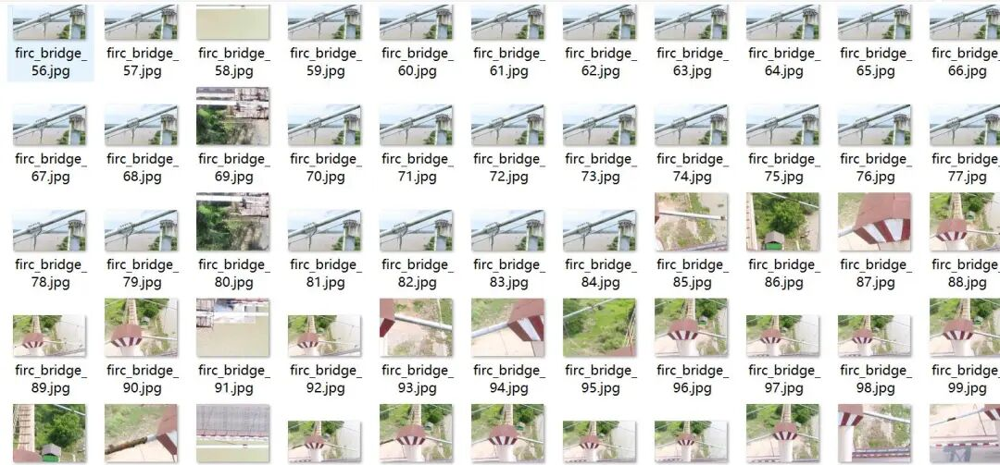
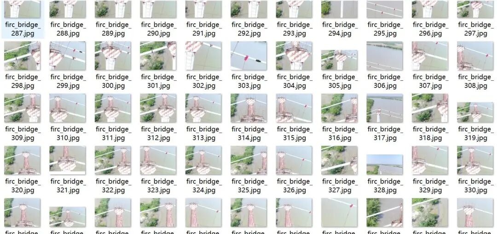
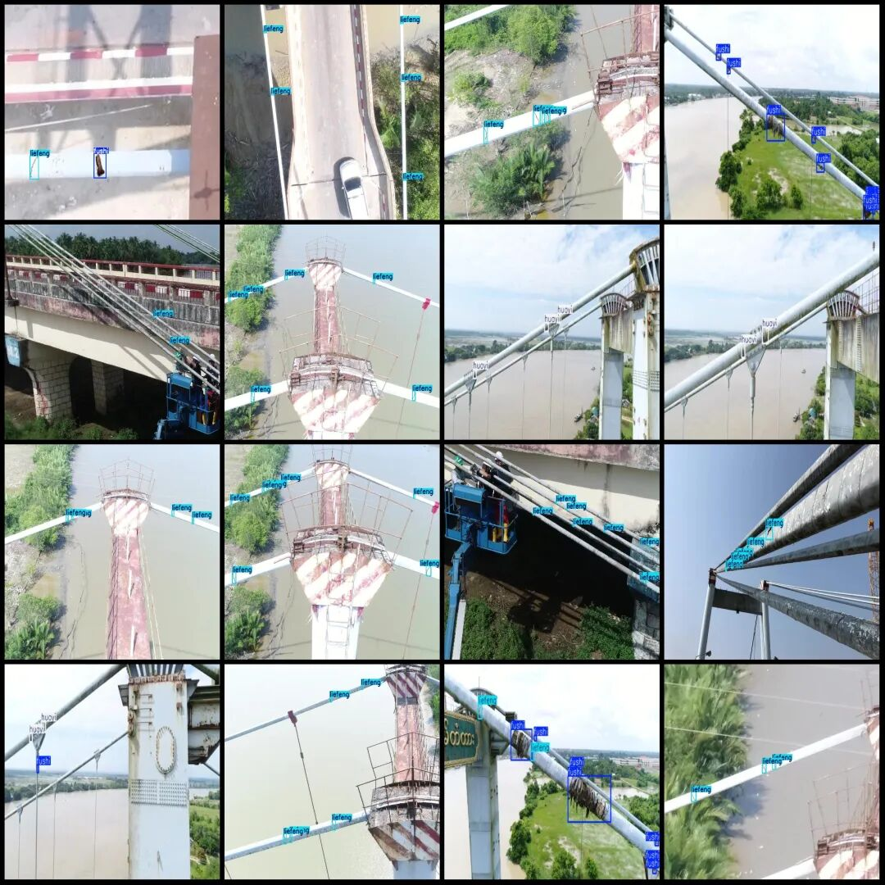

# UAV Perspective Inspection of Steel Cable Slender Bridge Corrosion Defects and Disease Detection Dataset in VOC+YOLO format with 1181 images across 3 categories

Dataset format: Pascal VOC format + YOLO format (txt file without split path, only containing jpg images and corresponding VOC format xml files and yolo format txt files)

Number of images (number of jpg files): 1181

Number of annotations (number of xml files): 1181

Number of annotations (number of txt files): 1181

Label category count: 3

Label category names (Note that the order of categories in the YOLO format does not correspond to this, but is based on the labels folder's classes.txt): ["fushi", "huayi", "liefeng"]

Number of boxes labeled in each category:

Fushi (corrosion) frame count = 1640

Huayi (Slip) Frame Count = 646

LieFeng (Crack) Frame Count = 2510

Total frame count: 4796

Drone: DJI MAVIC 3

Collection height: 80-100m

Sampling angle: 0-30°

Image resolution: Multi-resolution, such as 1500x1200, 800x448, etc.

Using labelImg:

Annotation rules: Draw a rectangle around the category.

Important Notice: No

Special : This dataset does not guarantee the accuracy of the trained models or weight files.

Image Preview:

Annotation example:

## Payment

Here is a pay link on Stripe ( https://buy.stripe.com/3cs8yP7sY87d0vu9AB ). Please contact me lonlonago@foxmail.com after funding $89, and I will send you a complete data files , thank you!

